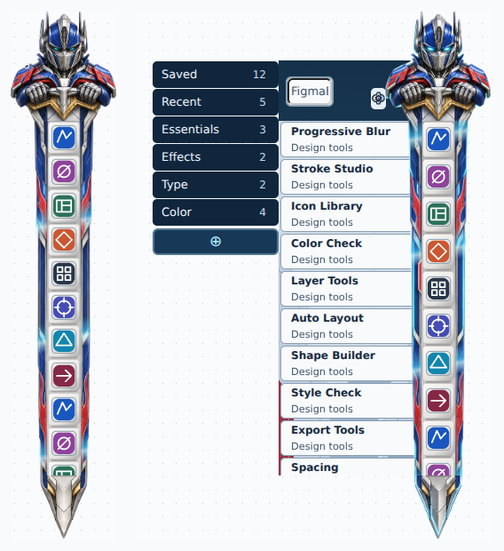

# FigmaEX 擎天柱 · 星辰剑 v1.6.0

[下载新版 ZIP](https://github.com/Torin12323/figmaex-optimus/releases/download/v1.6.0/figmaex-optimus-v1.6.0.zip) · [历史版本与更新记录](CHANGELOG.md)

## 三处改动

1. **收起时**，头盔、肩甲和双手护住金色剑格。头肩外宽 120px，刀身约 66px，剑尖沿中心线收束约 72px。插件图标落在银色分格中央。
2. **展开时**，插件列表在剑的左边展开。头肩、剑刃与剑尖仍在右侧，图标继续沿同一根中线排列。双眼和红蓝装甲切换为参考图的发光状态。
3. **新增目录**，左边「＋」独占最后一行，紧跟已有目录；添加分组后随内容下移。实际新增操作由 FigmaEX 处理。

## 安装

1. 下载 ZIP，**解压整个文件夹**，双击 `preview.html` 可先试用展开、收起和新增目录。
2. 用记事本打开 `optimus.css`（动态版）或 `optimus-static.css`（静态版），全选复制。
3. 在 FigmaEX 设置 → 皮肤 → 自定义 CSS 中，先备份旧 CSS，再全选替换并保存。所有角色图层都内嵌在 CSS 中。

普通收起宽度为 120px，紧凑模式为 98px；剑身旁的空白区域允许点击画布。展开面板继续使用宿主的宽度。剑身随可用列表高度伸缩。动态版在装甲边缘播放 1.6 秒流光，静态版和系统减少动态模式关闭持续动画。

## 验证与恢复

预览和截图基于 FigmaEX v1.5.101 的宿主样式与代表性结构。已检查展开前后的图标中心、头肩与剑尖高度、设置和新增目录的点击区域，以及少量和长列表的最后一项。实际扩展中的分组写入、运行插件与拖动仍需在安装环境确认。[本次实测数据](docs/check-v1.6.0.json)

如果旧皮肤让齿轮无法点击，按 F12 → Elements，搜索 `figmaEX_skin_style`，只删除对应的 `style` 元素。先别刷新，马上回到 FigmaEX 设置清除已保存的旧 CSS。[完整恢复步骤](FIGMAEX-SKIN-STANDARD.md)
